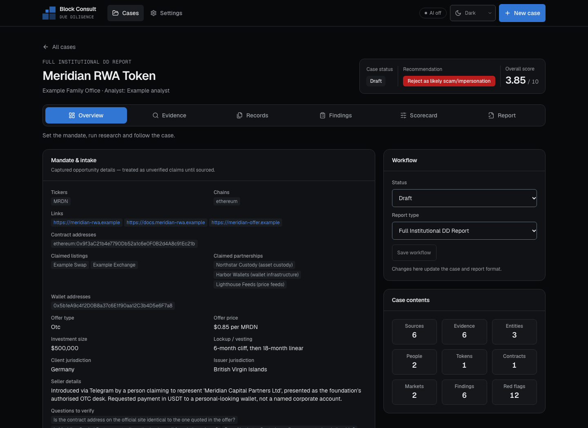
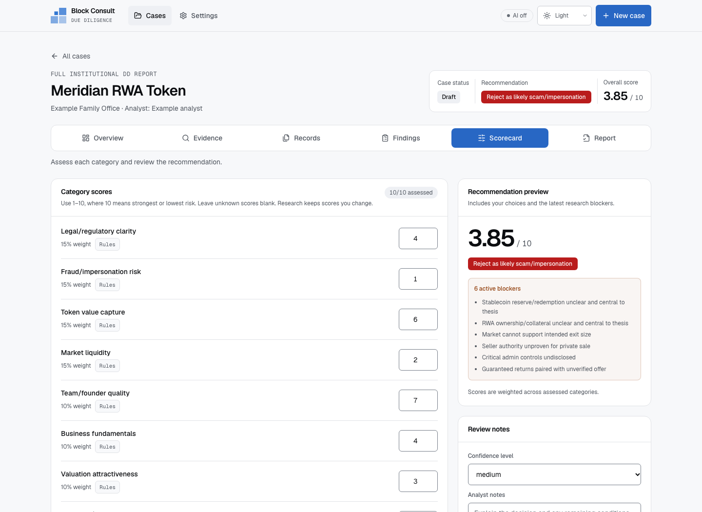

# Block Consult DD

A desktop workbench for due diligence on crypto, token, real-world asset (RWA), stablecoin and private-offer opportunities. Collect evidence, review findings, score a case and export a Block Consult report. Case records are stored locally. AI research is optional and uses your own provider account.

[Download the desktop app](https://github.com/blockconsult-org/block-consult-dd/releases/latest) · [Development guide](docs/development.md) · [Research and scoring](docs/architecture.md) · [Report an issue](https://github.com/blockconsult-org/block-consult-dd/issues)


## What you can do

- Organize cases by status, search the dashboard and find cases with red flags.
- Capture an offer, its entities, contracts, counterparties and questions. Optional AI extraction turns pasted material into a draft intake for you to review.
- Keep sources and evidence claims alongside findings, red flags and structured project records.
- Run rule-based checks, or use AI to research sources and propose findings with citations.
- Review category scores and blockers. Each score shows whether it came from an analyst, rules or AI; blockers can only lower the recommendation.
- Generate a saved report snapshot, export HTML, Markdown and an evidence manifest, or preview and export a PDF from the current case.

The interface uses Block Consult's light and dark palettes, with a system theme option, keyboard navigation and layouts for narrow windows.

## Download and install

The [latest release](https://github.com/blockconsult-org/block-consult-dd/releases/latest) contains the installers and release notes. The app bundles its server, SQLite database support and PDF renderer; you do not need Node.js or a separate database.

| Platform | Choose this download |
| --- | --- |
| macOS, Apple silicon | `Block-Consult-DD-0.2.0-mac-arm64.dmg` |
| macOS, Intel | `Block-Consult-DD-0.2.0-mac-x64.dmg` |
| Windows, Intel or AMD 64-bit | `Block-Consult-DD-0.2.0-win-x64.exe` |

Open the macOS disk image and drag the app to Applications, or run the Windows installer. Apple silicon and Intel Macs have separate builds because the database engine is native to each processor.

Check the release notes for signing details. The macOS downloads in this release are not notarized, and the Windows installer is unsigned, so operating-system security controls may block installation. Follow your organization's installation policy.

### First case

1. Open Block Consult DD and choose **Load example case** to explore the fictional Meridian RWA Token case, or create a new case.
2. Review the intake and add the sources you have. Missing evidence remains visible as missing.
3. Run the rule-based checks from the case overview. To use AI, choose and configure a provider in Settings first.
4. Review the findings and scorecard, including every active blocker.
5. Open the Report tab to generate a saved report or export the current case.



## Optional AI

The rule-based workflow works without an AI account. AI can extract intake fields, research public sources, propose findings and draft report prose. You review the results before using them.

| Connection | Requirement | Usage |
| --- | --- | --- |
| Claude API | Your Anthropic API key | Billed to your Anthropic account |
| OpenAI API | Your OpenAI API key | Billed to your OpenAI account |
| Claude Code | A locally installed, signed-in Claude Code CLI | Subject to your account and plan limits |
| Codex | A locally installed, signed-in Codex CLI | Subject to your account and plan limits |

AI requests send the relevant intake, evidence or report material to the selected provider. Web research also contacts external sources. Consider the confidentiality of a case before enabling these features. Settings shows usage and estimated API cost; estimates are not invoices.

Desktop API keys are encrypted through the operating system's credential storage. The app reports a saved key's presence and last four characters, never the full key. See [provider behavior and storage](docs/architecture.md#ai-providers) and the [security policy](SECURITY.md).

## Scores and report snapshots

Ten categories use a 1–10 scale, where a higher score means stronger evidence or lower risk. Nine categories contribute to the weighted result; transparency and disclosure is informational. An unscored category stays unknown. A high average cannot override a blocker.



Saved blockers persist when you reopen a case or run research. When upgrading an older database, the app conservatively retains recognized blockers from its saved labels. Review these retained choices in the scorecard and clear one only when the evidence supports doing so.

Each case has one latest saved report snapshot with an incrementing version number. Regenerating replaces that snapshot; it is not a history of every report version. Live HTML and PDF exports reflect the current case, which may differ from the saved snapshot. Export copies you need to retain.

Screenshots use the fictional example case. The tool supports professional review; its scores and reports are not legal, tax, accounting or investment advice. AI output can be incomplete or wrong, and a matching source quotation does not establish that the source's claim is true.

## Your data

Use **Help → Open data folder** in the desktop app. Default locations are:

| OS | Data folder |
| --- | --- |
| macOS | `~/Library/Application Support/Block Consult DD` |
| Windows | `%APPDATA%\Block Consult DD` |
| Linux | `~/.config/Block Consult DD` |

The folder holds the SQLite database, generated reports, fetched source text and application logs. Quit the app before copying the folder for a backup. The app also backs up the database before applying a schema upgrade. Encrypted API keys may require re-entry on another computer. Version 0.2.0 keeps the existing app identity and data location.

## Run from source

Requires Node.js 24 or newer and npm.

```bash
git clone https://github.com/blockconsult-org/block-consult-dd.git
cd block-consult-dd
npm ci
cp .env.example .env
npm run dev:direct
```

Open `http://localhost:3000`. The server listens on `127.0.0.1` and applies database migrations at startup. `npm run dev` uses a separately installed Portless proxy; use the URL it reports. For PDF export from source, install the browser with `npx playwright install chromium`.

```bash
npm run typecheck
npm run lint
npm test
npm run desktop:build
```

The last command builds installers for the current operating system and processor into `release/`. See the [development guide](docs/development.md) for packaging, signing, checks and team hosting. The [architecture guide](docs/architecture.md) explains research, score provenance and reports.

## Contributing and license

Read [CONTRIBUTING.md](CONTRIBUTING.md) before opening a pull request. Report vulnerabilities privately through the process in [SECURITY.md](SECURITY.md).

[MIT](LICENSE). Copyright © 2026 Block Consult GmbH. The license covers the code; it does not grant rights to use Block Consult's name or logo as an endorsement.
