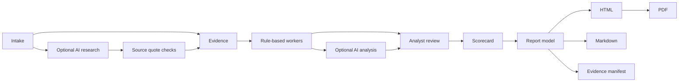
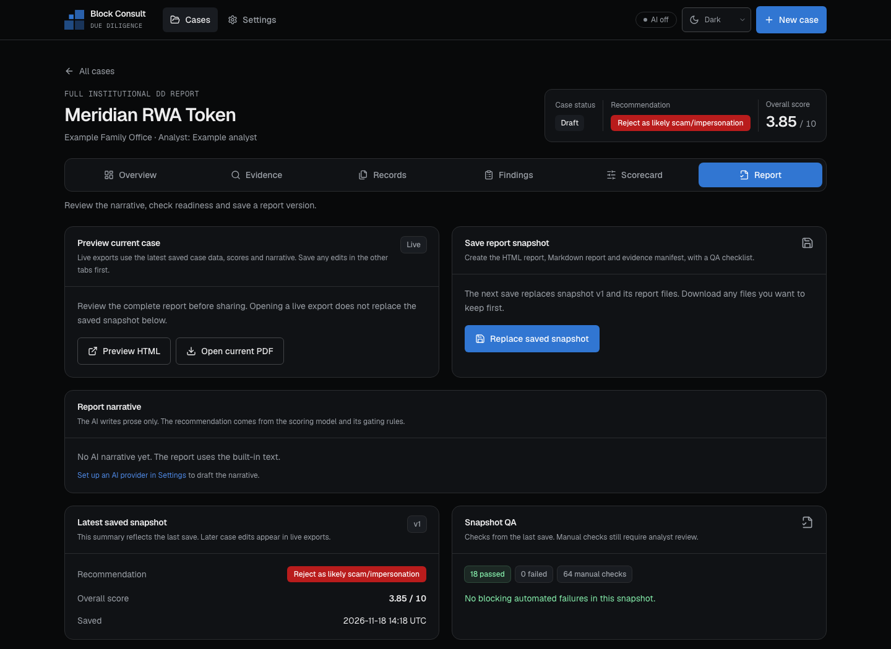

# Research, scoring and reports

Block Consult DD is a Next.js application with a SQLite database managed by Prisma. The Electron app starts the same application locally and supplies operating-system credential storage and Chromium PDF rendering. The desktop renderer has no Node.js integration.

## Case workflow

A case holds its intake, sources, evidence claims, entities, people, tokens, contracts, market records, findings, red flags, scorecard and report. Source and score provenance stays visible so the analyst can distinguish entered data from rules and AI proposals.

An AI research run searches for sources, saves proposed evidence, checks cited quotations, runs the rule-based workers and asks the provider to propose an analysis. The rule-only action skips AI research and analysis. Optional data connectors can still make network requests when configured.

Quote checking downloads cited pages and searches for the supplied text. A missing or unreachable quotation lowers confidence; a matching quotation only confirms that the text appears on the retrieved page. It does not verify the underlying claim. The downloader rejects private, loopback and link-local addresses and applies the checks again on redirects.

Research depth sets the requested web-tool budget:

| Depth | Searches | Page fetches |
| --- | ---: | ---: |
| Quick | 8 | 6 |
| Standard | 20 | 15 |
| Deep | 40 | 30 |

Provider adapters differ in how they expose and enforce tool budgets. The CLI adapters pass these limits in their instructions, so they are not a guaranteed spending cap.

## Workers and provenance

Workers implement the contract in [`src/harness/types.ts`](../src/harness/types.ts). A worker receives a read-only case snapshot and returns findings, flags, suggested scores, module output, confidence and logs. The orchestrator records a worker trace and combines the results.

The rule-based workers cover intake and search planning, identity, tokenomics, exchange and on-chain data, entities and teams, stablecoin/RWA structure, legal issues, fraud signals and citations. Connectors in [`src/harness/connectors/`](../src/harness/connectors/) provide optional web, market and explorer data. Missing connector data is reported as missing.

Later runs replace their earlier generated findings and flags while retaining analyst entries. AI research replaces earlier AI sources and claims on the next AI run. Category scores keep a provenance label: Analyst, Rules or AI. Research can update generated scores, but it preserves scores the analyst has set.

## Scoring and blockers

[`src/domain/scoring.ts`](../src/domain/scoring.ts) defines the scoring rules. Every category uses a 1–10 scale. For fraud and impersonation, 10 means the lowest risk.

| Category | Weight |
| --- | ---: |
| Legal/regulatory clarity | 15% |
| Fraud/impersonation risk | 15% |
| Token value capture | 15% |
| Market liquidity | 15% |
| Team/founder quality | 10% |
| Business fundamentals | 10% |
| Valuation attractiveness | 10% |
| Technical/smart contract safety | 5% |
| Partnership credibility | 5% |
| Transparency/disclosure quality | Informational |

The weighted result is normalized by the weights of scored categories. Unknown categories are excluded from that calculation and remain visible as unknown; the displayed average is not evidence that every category has been assessed.

Fifteen blockers impose recommendation ceilings. For example, an unknown legal instrument limits a case to Wait/monitor, unproven seller authority limits it to Reject, and a confirmed impostor domain limits it to Reject/likely scam. The final recommendation is the worse of the score band and all active ceilings.

Saved blockers and the latest research blockers are combined. Clearing a saved choice does not remove a blocker still present in research. The scorecard preview and report builder use the same combination.

Older databases stored blocker labels without their original provenance. Migration `0004_manual_gating` conservatively retains recognized labels as saved choices, even if some originally came from research. This avoids silently improving a recommendation during an upgrade. Review retained choices explicitly when reopening an older case.

## AI providers

The provider interface in [`src/ai/types.ts`](../src/ai/types.ts) supports the Claude API, OpenAI API, Claude Code CLI and Codex CLI. Settings chooses the active provider, model, effort and research depth. AI is off by default.

For an API connection, save your own provider key in Settings and use the connection and test-prompt actions. A test prompt makes a provider request and may incur usage charges. Claude API can also use an `ANTHROPIC_API_KEY` supplied to the process when that authentication option is selected. The key fields reject obvious cross-provider mistakes.

For a CLI connection, install and sign in to the CLI separately. The app looks for the executable or uses a path supplied in Settings. It runs each task in a temporary directory. The Claude Code adapter requests safe mode with web tools only; the Codex adapter requests a read-only sandbox and disables user configuration, rules, hooks, plugins, connected apps and subagents. These adapters depend on the installed CLI supporting their command-line options.

The app does not manage a CLI account's login. CLI availability, models, rate limits and subscription eligibility depend on the installed provider software and account. Test the selected connection on the computer that will run the research.

API credentials are encrypted through Electron safeStorage in the desktop app. Running from source uses AES-256-GCM with a local key. The settings API returns presence and a four-character hint, not the credential. The Usage view records call metadata, tokens, searches and estimated API costs, without storing prompts and answers in that usage log. Research evidence and generated narrative are stored with the case.

## Reports

[`src/report/build.ts`](../src/report/build.ts) assembles a report model from the case, scores, findings and research output. Rule-based prose is always available. An optional AI narrative can replace that prose while its input fingerprint is current; changed findings, scores or recommendations can make it stale.

The HTML renderer embeds its CSS and fonts in one document. The same HTML feeds Electron's PDF renderer in the desktop app or Playwright's Chromium when running from source. PDF rendering disables JavaScript and network access. Markdown and an evidence manifest are separate exports.

Report templates choose the included sections: Full Institutional, Quick Screen, Tokenomics, Liquidity, Stablecoin/RWA, Private Offer Verification, Founder/Team Dossier, Red-Flag, IC Memo and Executive Memo. The QA checklist surfaces missing information and blocking issues for review.

Each case has one latest saved report, with a version counter. Generating it updates that snapshot and its HTML, Markdown and evidence-manifest files. Live preview and PDF export rebuild from the current case. Live PDFs have independent file records and do not become evidence that the saved report contained those later values. Retain downloaded copies if you need an archive of earlier reports.

## Source map

| Directory | Responsibility |
| --- | --- |
| `electron/` | Desktop lifecycle, local server, credential and PDF bridges |
| `prisma/` | SQLite schema, migrations and fictional example seed |
| `scripts/` | Build, package, smoke-test and migration commands |
| `src/app/` | Next.js pages and API routes |
| `src/components/` | Dashboard, case workspace, settings and shared controls |
| `src/ai/` | Providers, prompts, schemas, research, analysis and narrative |
| `src/domain/` | Validation, enums, scoring, gating and score provenance |
| `src/harness/` | Research orchestration, workers and connectors |
| `src/report/` | Report model, templates, renderers and QA |
| `src/lib/` | Database, migrations, storage, secrets, safe fetch and branding |
| `src/content/` | Question bank, document requests, red-flag catalog and QA content |

The migration history is SQLite-specific. PostgreSQL support would require a new migration history and validation of the database behavior, rather than changing only the Prisma provider.
